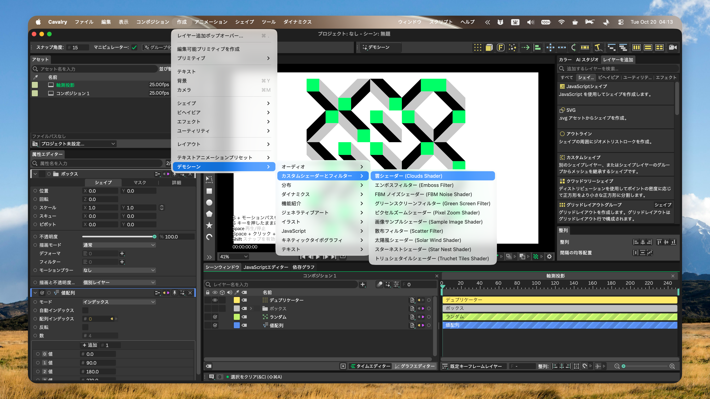

<!--
[INPUT]: 依赖 GitHub 最新正式 Release、当前发布配置、平台运行时边界与 LOCAL_BUILD_SOP
[OUTPUT]: 提供预览、2.8.0亮点、使用与恢复、Release安装说明及折叠的开发和翻译资料
[POS]: リポジトリの日本語ユーザー入口。英語と他のローカライズ README に公開の事実を同期し、実機検証の代替にはしない
[PROTOCOL]: 变更时更新此头部，然后检查 CLAUDE.md
-->

<div align="center">
  
  <h1>Cavalry-i18n</h1>
  <p>macOSとWindowsで、<a href="https://cavalry.scenegroup.co/">Cavalry</a> 2.8.0 の表示言語を英語、簡体字中国語、繁体字中国語、日本語に切り替えます。</p>
  <a href="https://github.com/daftAI2026/Cavalry-i18n/stargazers"></a>
  <a href="https://github.com/daftAI2026/Cavalry-i18n/releases/latest"></a>
  <a href="LICENSE"></a>

  <p>Languages: <a href="README.md">English</a> | <a href="README.zh-Hans.md">简体中文</a> | <a href="README.zh-Hant.md">繁體中文</a> | 日本語</p>
</div>

## プレビュー



Cavalry 2.8.0 の実機スクリーンショット。3 階層のメニュー、属性エディター、レイヤー名、レイヤー追加パネルを表示しています。

## 2.8.0 の主な変更

- Cavalry 2.8.0 のメニュー、ノード、属性、プラグインの説明、組み込みガイドの翻訳に対応。
- 公式デモのメニュー名、コンポジション名、作者が付けたレイヤー名を翻訳し、既存のユーザープロジェクトは書き換えません。
- タイムエディター、ビューポート、ツールチップの中国語・日本語のフォント表示を改善し、一部の日本語Quick Add検索を修正。
- パッチ適用後の言語切り替えを高速化し、設定の復元確認を進行状況に追加。

[p1 のすべての更新内容](https://github.com/daftAI2026/Cavalry-i18n/releases/tag/cavalry-2.8.0-p1)。

## 使い方

1. 作業を保存してCavalryを終了します。
2. Cavalry Language Switcherを開き、自動検出されたCavalry 2.8.0 のパスを確認します。インストール先を手動で選ぶこともできます。
3. 言語を選び、**「切り替える」** を押します。完了するとCavalryが自動で開きます。

Switcherの新しいバージョンがある場合は通知されます。現在の言語に更新バッジが表示されたら、その言語を選んで **「更新」** を押すと、言語リソースと必要なランタイムを更新できます。先に英語へ戻す必要はありません。リソースが最新の場合のみ、現在の言語は再選択できません。進行状況はボタンの下に表示されます。

**「英語に戻す」** は保存済みのプロファイル文字列を復元し、言語を英語に設定して、Switcherが所有するランタイムの変更を元に戻します。Switcherの書き込み後にプロファイルが変更されている場合は、復元を停止してその変更を保持します。Cavalryを再インストールする機能ではありません。必要なランタイムのベースラインがない、または無効な場合、アプリバンドルへの書き込みは停止します。

## 権限と復元

Cavalry Language Switcherは独立したコミュニティツールであり、Scene Group、Cavalry、Canvaとは提携していません。

SwitcherはローカルのCavalryインストールを変更します。バージョンが未対応、インストールを検証できない、または書き込みが拒否された場合、新しい言語は適用されません。

macOSでは、まず切り替えを直接試します。macOSが実際に書き込みを拒否した場合にだけ、**システム設定 → プライバシーとセキュリティ → App Management** を開きます。このビルドを信頼できる場合にのみ許可してください。再試行前にSwitcherを開き直すよう求められる場合があります。変更された `Cavalry.app` は、起動できるようローカルで再署名されます。

Windowsでは、現在のユーザーが書き込めるカスタムインストール先を直接処理します。UAC昇格はシステムのProgram Files配下にあるCavalryだけに限定されます。不明なDLLは削除も置換もしません。

## Release からインストール

[GitHub Releases](https://github.com/daftAI2026/Cavalry-i18n/releases/latest) からダウンロードします。macOSはApple SiliconまたはIntel向けDMG、Windowsはx64 NSISインストーラーです。

Cavalry 2.7.2 では、過去の [p12 Release](https://github.com/daftAI2026/Cavalry-i18n/releases/tag/cavalry-2.7.2-p12) を使用してください。

macOS：DMGを開き、アプリを「アプリケーション」にドラッグします。Windows：インストーラーを実行します。

<details>
<summary>macOSで初回起動がブロックされる場合</summary>

macOS版はad-hoc署名で、Appleの公証は受けていません。インストール後、初回起動がブロックされた場合は次を実行します。

```bash
xattr -dr com.apple.quarantine "/Applications/Cavalry Language Switcher.app"
codesign --force --deep --sign - "/Applications/Cavalry Language Switcher.app"
open "/Applications/Cavalry Language Switcher.app"
```

アプリ内更新では新しいapp bundleがインストールされるため、同じ手順が再度必要になる場合があります。

</details>

WindowsインストーラーはAuthenticode署名されておらず、「不明な発行元」と表示される場合があります。本プロジェクトのGitHub Releaseから取得したファイルであることを確認してください。

## 開発と貢献

ソースからビルドする場合は、まず [LOCAL_BUILD_SOP.md](LOCAL_BUILD_SOP.md) に従って固定ツールチェーンとプラットフォーム要件を準備し、次のコマンドを実行してください。

```bash
npm install
npm run tauri:dev              # ソースから実行
npm run build:tauri            # macOS DMG をビルド
npm run build:tauri:windows    # Windows 上で NSIS をビルド
```

```bash
npm run test:contracts         # Renderer、bridge、Release、パッケージの契約
npm run test:tauri             # Rust テスト
npm run check:app              # JavaScript 構文
```

2.8.0 の本番ビルドはQt 6.9.2 を使用します。Releaseパッケージでは固定ツールバージョンを使用し、[LOCAL_BUILD_SOP.md](LOCAL_BUILD_SOP.md) に従ってください。

### AI / Agent Guide

コードを変更する前に、[AGENTS.md](AGENTS.md)、[CLAUDE.md](CLAUDE.md)、対象モジュールに最も近い `CLAUDE.md` を確認してください。これらはアーキテクチャ、責務境界、コマンド、ドキュメント規約を定義します。

<details>
<summary>仕組み、翻訳元、リポジトリ構成、CI</summary>

### 仕組み

2.8.0 の言語パックは、ネイティブUIテキストと言語設定を現在のユーザーのCavalryプロファイルに書き込みます。過去の 2.7 JSONアセット上書きは使用しません。macOSでネイティブランタイムを変更する場合は、Cavalryの対象と公式ベースラインを検証します。ベースラインがない、または無効な場合、ランタイムへの書き込みを停止します。

1. 選択したCavalry 2.8.0 と組み込みリソースマニフェストを検証します。
2. 固定されたCavalry 2.8.0 カタログから構築した承認済み言語パックを読み込みます。
3. 言語設定と `strings.json` パックを現在のユーザープロファイルに適用します。
4. ランタイム変更が必要な場合は、検証済みのプラットフォーム別トランザクションを実行します。
5. 言語トランザクションの確定後にCavalryを開きます。

### 対応言語

| 言語 | コード |
|----------|------|
| English | `en` |
| 简体中文 | `zh-Hans` |
| 繁體中文 | `zh-Hant` |
| 日本語 | `ja_JP` |

### 翻訳サーフェス

2.8.0 のネイティブユーザープロファイルパックは、`languages/native/` の原文に紐づく承認済み訳文と、`tools/cavalry_native_target.json` に固定された公式カタログを使用します。`tools/native_resource_bundle.js` が 3 言語のパックを検証して構築します。生成パックは手動編集しないでください。

ビルダーは公式の `dontTranslate` 項目を標準で維持します。表示の例外は、IDと値を検証した 100 個の組み込みデモメニュー名だけです。プリセットのパス、モデル名、メニュー操作、ユーザー入力テキストは変更しません。

`languages/` のJSON上書きと `tools/*.ts` injector訳文は、別の過去またはランタイム経路です。Cavalry 2.8.0 のネイティブユーザープロファイルパックの翻訳元ではありません。生成されたinjectorテーブルも手動編集しないでください。翻訳規則と実機検証は [docs/translation-guidelines.md](docs/translation-guidelines.md) と [docs/runtime-ui-live-capture-workflow.md](docs/runtime-ui-live-capture-workflow.md) を参照してください。

### リポジトリ

```text
Cavalry-i18n/
├── renderer/          # Tauri WebView UI
├── src-tauri/         # Rust コマンドとプラットフォーム処理
├── injector/          # macOS / Windows Qt ランタイム翻訳
├── languages/         # 過去の JSON パックと 2.8.0 の承認済みネイティブ翻訳
├── tools/             # ビルド、検証、Release ツール
├── docs/              # 公開規則、再現可能な SOP、画像
└── .github/workflows/ # CI、プラットフォーム別パッケージ、Release 公開
```

### CI/CD

| Job | 役割 |
| --- | --- |
| `build` | 構文、契約、翻訳の検証 |
| `windows_check` | Windows翻訳、Rust、NSISライフサイクル、更新パッケージ |
| `package_macos` | Apple Silicon / Intel Tauriパッケージと成果物検証 |
| `release` | `cavalry-*-p*` tagに対する署名付き更新マニフェストと 7 個の公開成果物 |

</details>

## サポート

- Cavalry-i18nが役に立ったら、友人に[共有](https://twitter.com/intent/tweet?url=https://github.com/daftAI2026/Cavalry-i18n&text=Cavalry-i18n%20-%20Switch%20Cavalry%E2%80%99s%20UI%20between%20English,%20Chinese,%20and%20Japanese%20with%20one%20click.)するかstarを付けてください。
- 不具合は[報告フォーム](https://github.com/daftAI2026/Cavalry-i18n/issues/new?template=bug_report.yml)からお知らせください。アイデアやコードの提案もIssueまたはPRで歓迎します。

## ライセンス

MIT License。Cavalry-i18nを自由に使い、ぜひ貢献してください。
