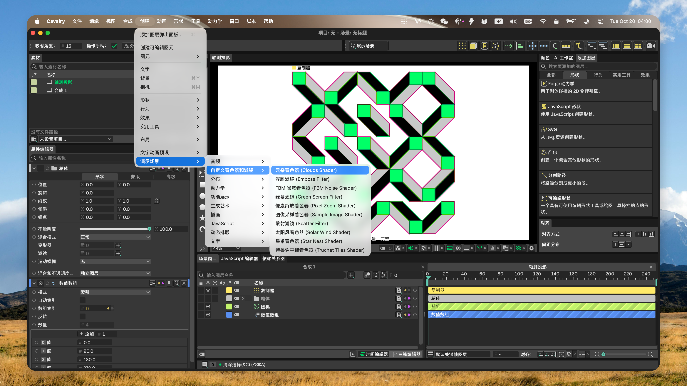

<!--
[INPUT]: 依赖 GitHub 最新正式 Release、当前发布配置、平台运行时边界与 LOCAL_BUILD_SOP
[OUTPUT]: 对外提供 Cavalry 2.8.0 用户配置语言切换与归属恢复、2.7.2 p12 历史链接、平台权限及翻译边界
[POS]: 仓库简体中文用户入口；与英文及其他本地化 README 同步发布真相，不替代平台真机验收
[PROTOCOL]: 变更时更新此头部，然后检查 CLAUDE.md
-->

<div align="center">
  
  <h1>Cavalry-i18n</h1>
  <p>直接在 macOS 或 Windows 原始应用中，将 <a href="https://cavalry.scenegroup.co/">Cavalry</a> 2.8.0 切换为 English、简体中文、繁體中文或日本語。</p>
  <a href="https://github.com/daftAI2026/Cavalry-i18n/stargazers"></a>
  <a href="https://github.com/daftAI2026/Cavalry-i18n/releases/latest"></a>
  <a href="LICENSE"></a>

  <p>Languages: <a href="README.md">English</a> | 简体中文 | <a href="README.zh-Hant.md">繁體中文</a> | <a href="README.ja_JP.md">日本語</a></p>
</div>

Cavalry 2.7.2 用户请使用历史版本 [p12 Release](https://github.com/daftAI2026/Cavalry-i18n/releases/tag/cavalry-2.7.2-p12)。

## 预览



## 功能

- **一步切换语言**：退出 Cavalry，选择语言并点击 **“切换”**；完成后 Cavalry 会自动打开。
- **四种界面语言**：English、简体中文、繁體中文和日本語。
- **双平台支持**：适用于 macOS 与 Windows x64 上的 Cavalry 2.8.0。
- **原生用户配置语言包**：通过当前用户的 Cavalry 配置写入 2.8 原生界面文本。
- **归属恢复**：只恢复语言切换器能够证明自己写入的配置与运行时内容。
- **自动发现与恢复**：查找常见安装位置、显示当前语言，并记录受支持恢复所需状态。
- **应用内更新**：发现后续 Switcher 版本时提醒用户，并在安装前完成验证。

## Switcher 窗口

选择目标语言，再点击 **“切换”** 或 **“恢复英文”**。当前语言旁出现更新徽章时，可以选择它并点击 **“更新”**，重新应用该语言的最新资源，无须先切换其他语言或恢复英文。只有资源已是最新时，当前语言才不可重复选择。操作进度和恢复指引显示在按钮下方。

2.8 语言包会将原生界面文本和语言设置写入当前用户的 Cavalry 配置。它不使用历史 2.7 JSON 资源覆盖。macOS 需要变更原生运行时时，会先验证 Cavalry 目标和官方基线。基线缺失或无效时，运行时写入会停止。

**“恢复英文”** 会恢复已保存的用户配置文本，并将语言设为英文。语言切换器拥有运行时内容时，会通过平台验证的恢复事务还原。用户在切换后修改配置时，操作会停止并保留这些修改。

## 安全与权限

Cavalry Language Switcher 是独立社区工具，不隶属于 Scene Group、Cavalry 或 Canva。

语言切换器会修改本机 Cavalry 安装。如果版本不受支持、无法验证安装或写入被拒绝，新语言不会生效。

在 macOS 上，它会先直接尝试切换。只有系统真实拒绝写入后，才会打开 **“系统设置 → 隐私与安全性 → App Management”**。仅在信任当前构建时授权；macOS 可能要求重新打开语言切换器后再试。修改后的 `Cavalry.app` 会在本地重新签名，以便正常启动。

在 Windows 上，当前用户可写的自定义目录会直接处理。UAC 提权仅用于系统 Program Files 目录中的 Cavalry 安装。未知 DLL 不会被删除或替换。

**“恢复英文”** 只还原已记录的用户配置文本和语言切换器拥有的运行时。若所需运行时基线缺失或无法验证，操作会在写入 app bundle 前停止。它不会重新安装 Cavalry。

## 从 Release 安装

从 [GitHub Releases](https://github.com/daftAI2026/Cavalry-i18n/releases/latest) 下载对应安装包：Apple M DMG、Intel DMG 或 Windows x64 NSIS。

macOS 版本使用 ad-hoc 签名，尚未经过 Apple 公证。将应用拖入“应用程序”后，如果 macOS 阻止首次打开，请运行：

```bash
xattr -dr com.apple.quarantine "/Applications/Cavalry Language Switcher.app"
codesign --force --deep --sign - "/Applications/Cavalry Language Switcher.app"
open "/Applications/Cavalry Language Switcher.app"
```

应用内更新会安装新的 app bundle，因此 macOS 可能要求再次执行这些步骤。Windows 安装器尚未进行 Authenticode 签名，可能显示“未知发布者”；请确认文件来自本项目的 GitHub Release。

源码构建请遵循 [LOCAL_BUILD_SOP.md](LOCAL_BUILD_SOP.md)。

## 快速开始

```bash
npm install
npm run tauri:dev              # 从源码运行
npm run build:tauri            # 构建 macOS DMG
npm run build:tauri:windows    # 在 Windows 上构建 NSIS
```

请使用仓库固定的 Node、Rust、Qt、Python 与 Windows CMake 工具链。平台依赖和打包检查以 [LOCAL_BUILD_SOP.md](LOCAL_BUILD_SOP.md) 为准。

## 工作原理

1. 验证所选 Cavalry 2.8.0 安装和内嵌原生资源清单。
2. 加载由固定 Cavalry 2.8 目录构建的已批准语言包。
3. 将语言设置和 `strings.json` 包写入当前用户的 Cavalry 配置。
4. 需要变更运行时时，调用经过验证的平台原生运行时事务。
5. 语言事务提交后打开 Cavalry。

**“恢复英文”** 会恢复已保存的用户配置文本、将语言设为英文，并还原语言切换器拥有的运行时。若用户在切换后修改配置，事务会停止，不会覆盖修改。

## 支持语言

| 语言 | 代码 |
|----------|------|
| English | `en` |
| 简体中文 | `zh-Hans` |
| 繁體中文 | `zh-Hant` |
| 日本語 | `ja_JP` |

## 开发

```bash
npm run test:contracts         # Renderer、bridge、发布与打包合同
npm run test:tauri             # Rust 测试
npm run check:app              # JavaScript 语法
```

2.8.0 生产构建使用 Qt 6.9.2。发布包不得依赖浮动工具版本；请遵循 [LOCAL_BUILD_SOP.md](LOCAL_BUILD_SOP.md)。

## AI / Agent Guide

修改代码前，请阅读 [AGENTS.md](AGENTS.md)、[CLAUDE.md](CLAUDE.md) 和目标模块最近的 `CLAUDE.md`。这些文件定义架构地图、职责边界、命令和文档协议。

## 翻译面

2.8.0 原生用户配置包使用 `languages/native/` 中绑定原文的批准译文，并读取固定在 `tools/cavalry_native_target.json` 的官方目录。`tools/native_resource_bundle.js` 会校验并构建三种目标语言包。不要手动修改生成包。

构建器默认保留官方 `dontTranslate` 条目。显示例外只覆盖 100 个身份和译值均已核对的内置示例菜单标签。它不会修改预设路径、模型名称、菜单动作或用户输入文本。

`languages/` 中的 JSON 覆盖包和 `tools/*.ts` 注入器译文属于独立的历史或运行时路径，不是 Cavalry 2.8 原生用户配置包的来源。生成的注入器表也不得手动修改。翻译规则和实机验证流程见 [docs/translation-guidelines.md](docs/translation-guidelines.md) 与 [docs/runtime-ui-live-capture-workflow.md](docs/runtime-ui-live-capture-workflow.md)。

## 仓库结构

```text
Cavalry-i18n/
├── renderer/          # Tauri WebView 界面
├── src-tauri/         # Rust 命令与平台事务
├── injector/          # macOS 与 Windows Qt 运行时翻译器
├── languages/         # 历史 JSON 包与 2.8 原生批准译文
├── tools/             # 构建、验证与发布工具
├── docs/              # 公开规则、可重复 SOP 与图片
└── .github/workflows/ # CI、平台打包与 Release 发布
```

## CI/CD

| Job | 职责 |
| --- | --- |
| `build` | 语法、合同与翻译验证 |
| `windows_check` | Windows 翻译器、Rust、NSIS 生命周期与更新包 |
| `package_macos` | Apple Silicon 与 Intel Tauri 打包及产物检查 |
| `release` | 为 `cavalry-*-p*` tag 发布签名更新清单与七项精确回读资产 |

## 支持

- 如果 Cavalry-i18n 帮到了你，可以把它[分享](https://twitter.com/intent/tweet?url=https://github.com/daftAI2026/Cavalry-i18n&text=Cavalry-i18n%20-%20Switch%20Cavalry%E2%80%99s%20UI%20between%20English,%20Chinese,%20and%20Japanese%20with%20one%20click.)给朋友，或点一个 star。
- 遇到 bug？请使用[问题反馈模板](https://github.com/daftAI2026/Cavalry-i18n/issues/new?template=bug_report.yml)。想法或代码贡献也欢迎提交 Issue 或 PR。

## 许可证

MIT License。欢迎使用 Cavalry-i18n 并参与贡献。
